 

  

  <strong>Building what shouldn't exist.</strong>
   
  Systems programming · Operating systems · Open-source software

  
  

---

I'm a developer interested in building software from the ground up — from operating-system internals to native desktop applications.

I prefer understanding how things work rather than treating them as black boxes. My projects are where I experiment, break things, learn, and build something better.

**Current interests:** Rust, kernel development, operating systems, native applications, and low-level programming.

---

## `01` — Featured projects

### Kestrel OS

A custom x86-64 operating system written in Rust, built from the ground up.

- Custom kernel and low-level system components
- Memory management and scheduling
- UEFI boot through Limine
- An evolving experimental OS project

[Explore Kestrel →](https://github.com/AverageCodeNerd/Kestrel)

### Pulse

A native Windows Task Manager alternative focused on speed and a modern desktop experience.

[Explore Pulse →](https://github.com/AverageCodeNerd/Pulse)

### Harbor

Another project in my collection of experiments and tools.

[Explore Harbor →](https://github.com/AverageCodeNerd/Harbor)

  <a href="https://github.com/AverageCodeNerd?tab=repositories">View all repositories →</a>

---

---

---

  <a href="https://github.com/AverageCodeNerd?tab=repositories">Explore my work</a>
  ·
  <a href="https://github.com/AverageCodeNerd?tab=activity">Recent activity</a>

